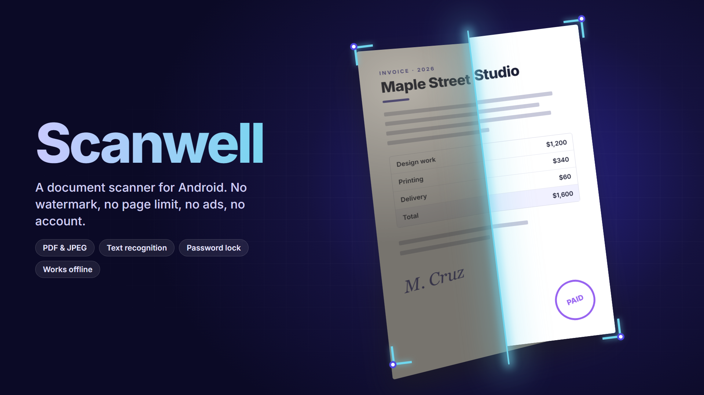
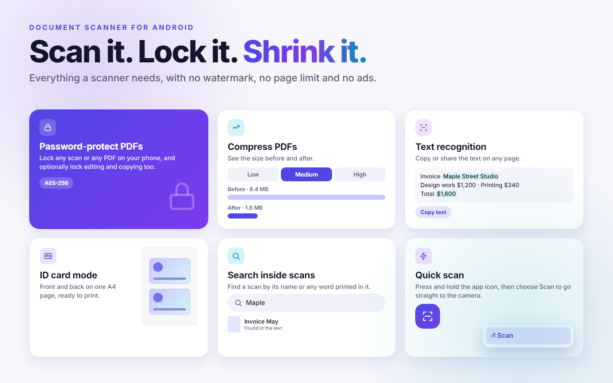

# Scanwell

**A document scanner for Android. No watermark, no page limit, no ads, no account.**

## About

Scanwell turns your phone into a scanner. Capture paper documents, save them as clean PDFs, copy the text out of them, and keep everything organized on your phone.

*The images above are illustrations, not screenshots.*

## Features

- **Scan:** automatic edge detection, cropping and image filters. You can also import photos from your gallery.
- **Export:** share or save as PDF or JPEG, with no watermark. Choose from three PDF sizes for email and upload limits.
- **Password-protect PDFs:** lock any scan, or any PDF on your phone, with a password (AES-256). You can also lock editing and copying. You can open protected PDFs and remove a password you know.
- **Compress PDFs:** shrink a PDF to Low, Medium or High and see the size before and after. Your original is never changed.
- **Text recognition:** copy or share the text on any page.
- **Search:** find a scan by its name or by any word printed inside it.
- **Organize:** rename scans and file them in folders.
- **Edit pages:** add more pages to a scan, reorder them, or delete them.
- **ID card mode:** scan the front and back of a card onto one A4 page, ready to print.
- **Quick scan:** press and hold the app icon and choose **Scan** to go straight to the camera.

## Privacy

- Your scans are stored only on your phone, in the app's private storage.
- Scanwell has no accounts, no ads, no analytics of its own, and no servers.
- Scanning and text recognition run on the phone through [Google ML Kit](https://developers.google.com/ml-kit). ML Kit sends Google some technical information, such as the device model and performance data, for diagnostics. See Google's [ML Kit data disclosure](https://developers.google.com/ml-kit/android-data-disclosure).
- Passwords are used to lock or unlock a file and then forgotten. They are never stored, logged or sent anywhere, and a forgotten password cannot be recovered.
- Uninstalling Scanwell deletes your scans, so export anything you want to keep.

## Getting started

1. Download the latest APK from the [Releases page](https://github.com/direkjames/Scanwell/releases/latest) on your phone.
2. Open the file. If Android asks, allow installs from the app you opened it with. Google Play Protect may warn you because the app is not on the Play Store yet. Choose to install anyway.
3. Open Scanwell and press **Scan**.
4. Save your scan as a PDF or JPEG, or tap a tool to lock or compress a PDF.

## Requirements

- Android 8.0 or newer
- Google Play services, which handles the scanner and the text reader
- At least 1.7 GB of RAM
- Internet the first time you scan or read text, while Google Play services downloads those parts. After that, Scanwell works offline.

## Built with

- Kotlin and Jetpack Compose with Material 3
- Google ML Kit (Document Scanner and Text Recognition)
- PDFBox for Android, for PDF encryption and compression

Want to build it yourself? See [Developing Scanwell](docs/DEVELOPING.md).

## Status

Shipped.

## Credits / License

Made by [direkjames](https://github.com/direkjames). See [LICENSE](LICENSE).
